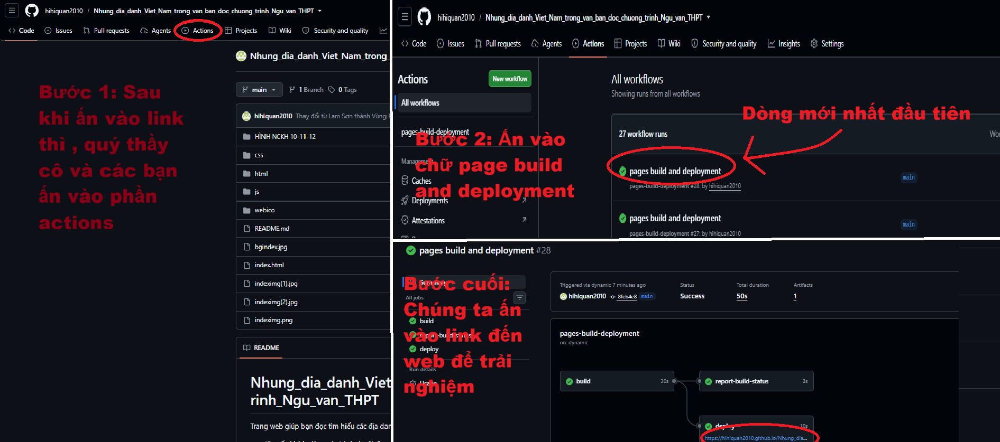

# Nhung_dia_danh_Viet_Nam_trong_van_ban_doc_chuong_trinh_Ngu_van_THPT
Trang web giúp bạn đọc tìm hiểu các địa danh bằng bản đồ số
 
<strong> * Khuyến khích dùng các trình duyệt được cập nhật thường xuyên như Chrome,Cốc Cốc,... để có trải nghiệm tốt nhất </strong>

<strong> CẬP NHẬT   QUÝ THẦY CÔ VÀ CÁC BẠN CÓ THỂ TRUY CẬP https://diadanhvanhoc.com/ để xem</strong>

## Phân chia dữ liệu và dịch vụ

| Thành phần | Nhà cung cấp | Dữ liệu / nhiệm vụ |
|---|---|---|
| Giao diện và mã nguồn | GitHub Pages | Phục vụ HTML, CSS, JavaScript tĩnh; không chứa Gemini key hay Supabase service-role key. |
| Tài khoản và nội dung | Supabase Auth + PostgreSQL | Hồ sơ và tên hiển thị; bài viết gồm tiêu đề, tác phẩm/địa danh, phân tích, đường dẫn ảnh; bình luận. |
| Ảnh và tệp | Supabase Storage | Bucket `community-media` lưu ảnh bài viết/avatar; database chỉ lưu đường dẫn. Giới hạn hiện đặt 5 MB/ảnh, chỉ JPEG/PNG/WebP. |
| Kiểm duyệt | Gemini API qua Supabase Edge Function | Kiểm duyệt tiêu đề, tác phẩm, phân tích, bình luận và tên hiển thị trước khi ghi database. Chỉ gửi văn bản cần kiểm duyệt tới Gemini, không gửi ảnh. |

Trang [Cộng đồng](./community.html) hiển thị 50 bài viết mới nhất cùng bình luận.
Quyền ghi trực tiếp từ trình duyệt bị thu hồi; chỉ Edge Function mới ghi bài/bình luận
sau khi xác thực tài khoản và Gemini duyệt. Nếu AI lỗi, trả kết quả không hợp lệ
hoặc hết quota, nội dung bị từ chối và không lưu (fail closed). Server giới hạn tối
đa 10 lượt kiểm duyệt/phút toàn hệ thống và 3 lượt/phút/tài khoản để giảm nguy cơ
cạn quota.

Header, tìm kiếm và footer được dùng chung từ `js/site_chrome.js` trên trang chủ,
cộng đồng, minigame và các trang địa danh.

### Vai trò cộng đồng

Mọi tài khoản mới mặc định có role `users`; chỉ Owner được cấp Moderator cho tài
khoản đã xác nhận email. Moderator có thể kiểm duyệt bài và đề xuất cấm tài khoản
users; đề xuất cần một Moderator khác duyệt. Owner có thể cấm trực tiếp và đăng
thông báo trên trang chủ. Role, lệnh cấm và nhật ký bảo mật được kiểm tra phía
Supabase/Edge Function; không trao quyền chỉnh sửa repository hay GitHub Pages.

Sau khi migration vai trò đã được áp dụng lên đúng project, đăng nhập Supabase CLI
bằng tài khoản quản trị project rồi chạy
`bash scripts/setup-owner.sh <supabase-project-ref>` để cấp Owner đầu tiên cho
một tài khoản đã đăng ký và xác nhận email. Script hỏi email trực tiếp trong
terminal và không ghi email vào mã nguồn. Chỉ một Owner ban đầu được tạo; các
Moderator được quản lý sau đó trong giao diện Cộng đồng.

### Chạy cộng đồng trên máy này

Yêu cầu: Docker Desktop đang chạy, Node.js, Supabase CLI và Git Bash. Tạo Gemini API
key trong [Google AI Studio](https://aistudio.google.com/apikey); **không gửi key
qua chat, không đặt key vào JavaScript**.

1. Mở Git Bash trong thư mục dự án, chạy `bash scripts/setup-gemini-local.sh` và
   nhập key tại prompt ẩn. Script chỉ lưu vào `supabase/.env.local`, file đã được
   bỏ qua bởi Git.
2. Chạy `bash scripts/run-community-local.sh`. Script khởi động Supabase local,
   áp dụng migration vào database **local**, tạo cấu hình trình duyệt dùng API/key
   local và chạy Edge Function. Nó không kết nối project Supabase từ xa.
3. Mở Git Bash thứ hai cùng thư mục, chạy `python -m http.server 8765`, rồi vào
   `http://127.0.0.1:8765/community.html`. Email đăng ký thử nghiệm được xem trong
   Supabase Mailpit local tại `http://127.0.0.1:54324`; Studio local ở
   `http://127.0.0.1:54323`.
4. Nhấn Ctrl+C ở cửa sổ chạy Edge Function để dừng. Không chạy `supabase db reset`
   nếu chưa muốn xóa dữ liệu trong database local.

`bash scripts/setup-local.sh` vẫn có thể dùng để nhập URL/key publishable của một
project Supabase vào cấu hình trình duyệt, nhưng thao tác đó không chạy migration
hoặc triển khai Edge Function.

### Gói miễn phí và quota

Dung lượng Storage, băng thông, giới hạn database và quota Gemini phụ thuộc gói,
model, khu vực và trạng thái project. Con số như 500 MB database, 1 GB Storage hay
15 request/phút không phải cam kết cố định của ứng dụng. Hãy xem mức quota đang áp
dụng trong Supabase dashboard và [Gemini API rate limits](https://ai.google.dev/gemini-api/docs/rate-limits);
Google lưu ý giới hạn thay đổi theo model/project và không được đảm bảo. Gemini
free-tier cũng chịu điều khoản xử lý dữ liệu của nhà cung cấp; cân nhắc điều này
trước khi gửi nội dung cá nhân/nhạy cảm để kiểm duyệt.

### Triển khai Supabase và GitHub Pages

`.github/workflows/deploy.yml` triển khai GitHub Pages khi có push lên nhánh `main`.
Trước khi deploy, chạy `bash scripts/setup-gemini-local.sh` để nhập Gemini key tại
prompt ẩn; key sẽ ở trong file local bị Git bỏ qua. Sau khi xác định đúng project
ref Supabase, chạy
`bash scripts/deploy.sh --confirm-deploy <supabase-project-ref>`. Script chạy các
migration trên project đó, lưu Gemini key làm Edge Function secret, deploy
`community-api`, cập nhật GitHub secrets, tạo commit và push lên nhánh mặc định.
Không dán Gemini key vào lệnh, chat hoặc mã nguồn.

Chỉ dùng anon/publishable key ở trình duyệt; tuyệt đối không đặt `service_role` key
hoặc Gemini key trong GitHub Pages. Workflow tạo cấu hình client từ GitHub secrets
trong lúc deploy. Nếu bật xác nhận email trên Supabase từ xa, người dùng cần xác
nhận email trước khi đăng nhập.
